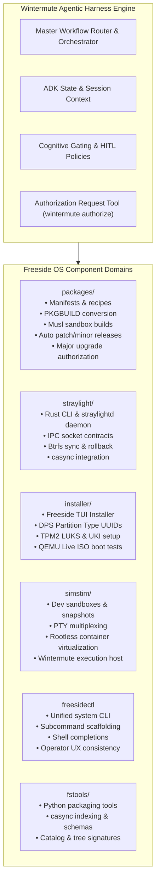
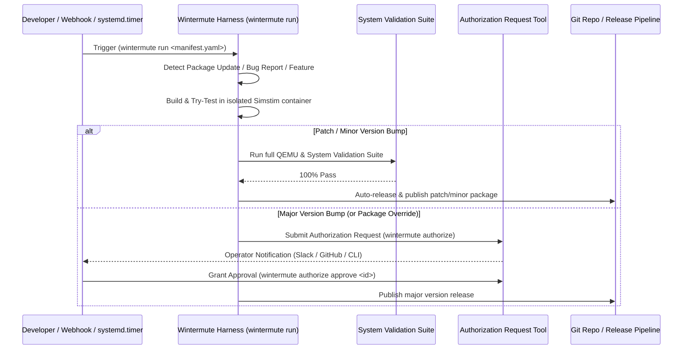

# Wintermute: The Autonomous Agentic Platform for Freeside OS

> [!NOTE]
> This document outlines the architectural blueprint and operational vision for **Wintermute**—evolving it from a package developer helper into a full agentic development harness and platform engine for Freeside OS.

---

## 1. Executive Summary & Vision

**Wintermute** is expanding beyond package recipe management to become the primary agentic engine through which developers create, test, maintain, and release Freeside OS.

Instead of operating solely as a CLI helper for isolated package builds, Wintermute functions as an **Autonomous Development Harness**. It orchestrates cross-repository features, triages bug reports, drafts and implements Freeside Language & Enhancement Proposals (FLIPs), manages security updates (CVEs), runs automated QEMU boot integration tests, and publishes patch releases.

---

## 2. Platform Domain Matrix

Wintermute organizes its capabilities into specialized domain agents tailored to Freeside OS repositories and core subsystems:



### Component Breakdown

| Subsystem / Repo | Technology Stack | Primary Wintermute Responsibilities |
| :--- | :--- | :--- |
| **`packages/`** | TOML, Just, Musl sandbox | Package creation (`create`), Arch conversion (`import`), container builds (`fix`), dependency auditing (`review`), version bumps (`upgrade`), patch/minor auto-releases, major version authorization requests. |
| **`straylight/`** | Rust, Tokio, IPC Sockets | Diagnostic `cargo check/clippy` fixes, daemon/client RPC contract verification, `casync` diff performance benchmarking. |
| **`installer/`** | Rust, Ratatui, systemd-boot | Partitioning logic updates ([FLIP-0001](docs/flips/FLIP-0001-discoverable-partitions-spec.md)), QEMU headless Live ISO installation & boot verification. |
| **`simstim/`** | Btrfs CoW, PTY, Linux Namespaces | Managing developer workstation sandboxes, serving as Wintermute's isolated runtime container for safe code execution. |
| **`freesidectl`** | Rust (Planned CLI) | Bootstrapping command structure from concept/FLIPs, auto-implementing system management subcommands, maintaining shell completions. |
| **`fstools/`** | Python, TOML, casync | Schema verification ([file_schemas.md](docs/reference/file_schemas.md)), repository catalog indexing (`channel.toml`, `trees/`), chunk verification. |

---

## 3. Harness Architecture & Interface Modes

Wintermute provides two primary operational entrypoints:

```text
 ┌─────────────────────────────────────────────────────────────────────────┐
 │                            User / Trigger                               │
 └────────────────────────────┬────────────────────────────┬───────────────┘
                              │                            │
                              ▼                            ▼
                 ┌──────────────────────────┐   ┌──────────────────────────┐
                 │ Interactive CLI          │   │ Unified Manifest Runner  │
                 │ (wintermute cli)         │   │ (wintermute run          │
                 │                          │   │  <manifest.yaml>)        │
                 └────────────┬─────────────┘   └──────────┬───────────────┘
                              │                            │
                              └──────────────┬─────────────┘
                                             │
                                             ▼
                         ┌───────────────────────────────────────┐
                         │    Wintermute Core Engine (ADK)       │
                         │  • ExecutionSpec Dispatcher           │
                         │  • Namespaced Registry Library        │
                         │  • Simstim Sandbox Execution Runner   │
                         │  • System Test & Validation Suite     │
                         │  • Authorization Request Tool         │
                         └───────────────────────────────────────┘
```

1. **Interactive CLI (`wintermute cli <domain> <workflow>`)**: Interactive developer shell for pair programming, real-time debugging, manual workflow triggers, and scaffold generation.
2. **Unified Manifest Runner (`wintermute run <path.yaml>`)**: Single entrypoint for all declarative Kubernetes-style YAML manifests. Inspects `kind:` (`Workflow` vs `EventHandler`) and dispatches execution. Periodically invoked by external schedulers (`systemd.timer`, Kubernetes `CronJob`, CI cron jobs).

---

## 4. Kubernetes-Style Declarative Manifests

Wintermute uses a unified, Kubernetes-style resource specification format (`apiVersion`, `kind`, `metadata`, `spec`).

### A. `kind: Workflow` (Procedural Execution Blueprint)

Executable on-demand via `wintermute run workflow.yaml` or triggered by system timers:

```yaml
apiVersion: "wintermute.freeside.os/v1"
kind: Workflow
metadata:
  name: "release-audit"
  description: "Scans packages for updates, checks straylight RPC contracts, and verifies installer QEMU boot."

spec:
  domain: "packages"
  execution_env: "host"

  steps:
    - name: "scan-cves"
      domain: "packages"
      workflow: "security_audit"
      params:
        auto_promote_patch: true

    - name: "check-straylight-clippy"
      domain: "straylight"
      workflow: "clippy_fix"
      params:
        deny_warnings: true

    - name: "test-installer-qemu"
      domain: "installer"
      workflow: "qemu_boot_test"
      params:
        disk_format: "btrfs-luks"
        dps_uuid_check: true

  gating:
    on_success: "run_system_validation_suite"
    on_failure: "notify_operator"
```

> [!TIP]
> **Scheduled Runs**: Run via native system timer:
> `systemd-run --on-calendar="Sun *-*-* 00:00:00" wintermute run .wintermute/workflows/release-audit.yaml`

### B. `kind: EventHandler` (Long-Running Event Listener)

Executable via `wintermute run handler.yaml` as a background listener process:

```yaml
apiVersion: "wintermute.freeside.os/v1"
kind: EventHandler
metadata:
  name: "github-event-listener"
  description: "Listens for GitHub webhooks and dispatches triage workflows"

spec:
  source:
    type: "webhook"          # Options: webhook, github_polling, kafka, fs_watcher, custom
    module: "wintermute.sources.github_webhooks"
    config:
      port: 8080
      events:
        - "push"
        - "issues"
        - "security_advisory"

  handlers:
    - event: "issues.opened"
      workflowRef: ".wintermute/workflows/triage-issue.yaml"

    - event: "security_advisory"
      workflowRef: ".wintermute/workflows/cve-patch.yaml"
```

---

## 5. Autonomous Workflows & Package Release Rules

Wintermute coordinates end-to-end development lifecycles across the OS:



### Core Autonomous Rules:

1. **Package Version Management**:
   * **Patch & Minor Versions**: Automatically built, tested, and released upon passing tests (unless overridden per-package in `package.manifest`).
   * **Major Versions**: Automatically detected, fetched, and try-tested in isolated container environments. If successful, Wintermute triggers an **Authorization Request Tool** (`wintermute authorize`) to prompt the operator for approval before publishing.
2. **Comprehensive System Validation Suite**:
   * Before any Autopilot release promotion (patch, minor, or authorized major), Wintermute executes a mandatory system validation suite:
     * Full headless QEMU Live ISO boot check.
     * Package topological dependency resolution audit.
     * Systemd unit syntax & service startup check.
     * Btrfs subvolume transaction and sync integrity test.
3. **Bug Triage & Reproducer Generation**:
   * Parses stack traces or bug reports.
   * Generates a failing test inside a `simstim` sandbox.
   * Iterates on code until tests pass, verifying zero regression.
4. **FLIP (Specification) Implementation**:
   * Parses architectural designs (e.g., [FLIP-0001](docs/flips/FLIP-0001-discoverable-partitions-spec.md)).
   * Coordinates multi-repository changes across `installer`, `straylight`, and `freesidectl`.
   * Verifies changes end-to-end before submitting PRs.

---

## 6. Cognitive Gating & Authorization Framework

To ensure human oversight on critical system boundaries, Wintermute enforces a structured authorization workflow:

> [!IMPORTANT]
> **Tier 0: Autopilot (Unattended)**
> * Formatting, linting, and doc fixes.
> * Patch & minor package updates (with 100% System Validation Suite pass).
> * Minor package manifest dependency alignments.

> [!CAUTION]
> **Tier 1: Authorized Gate (Requires `wintermute authorize`)**
> * Major version package upgrades.
> * Code changes to core Rust logic in `straylight` or `installer`.
> * Schema mutations in `fstools` or profile registry changes.
> * New FLIP implementations or system architecture alterations.

---

## 7. Actionable Implementation Roadmap

1. **Phase 1: Multi-Component Domain Architecture & Types**
   * Implement custom types (`DomainKind`, `WorkflowKind`), `ExecutionSpec` dataclass, `RegistryLibrary` namespace loader, and domain modules (`packages`, `straylight`, `installer`, `simstim`, `freesidectl`, `fstools`).
2. **Phase 2: Unified Manifest Runner (`wintermute run`)**
   * Implement K8s-style manifest parser (`kind: Workflow` and `kind: EventHandler`) with pluggable `tasks.source` Python adapters.
3. **Phase 3: System Schedulers & Integration**
   * Connect `wintermute run` to external system schedulers (`systemd.timer` templates).
4. **Phase 4: Authorization Request Tool & System Release Suite**
   * Build `wintermute authorize` CLI/Slack/GitHub integration tool.
   * Build the System Validation Suite (QEMU boot, Btrfs sync check, systemd unit checks).
5. **Phase 5: FLIP & Issue-to-Release Pipeline**
   * Connect bug triage, reproducer generation, major/minor package release rules, and automated PR staging.
