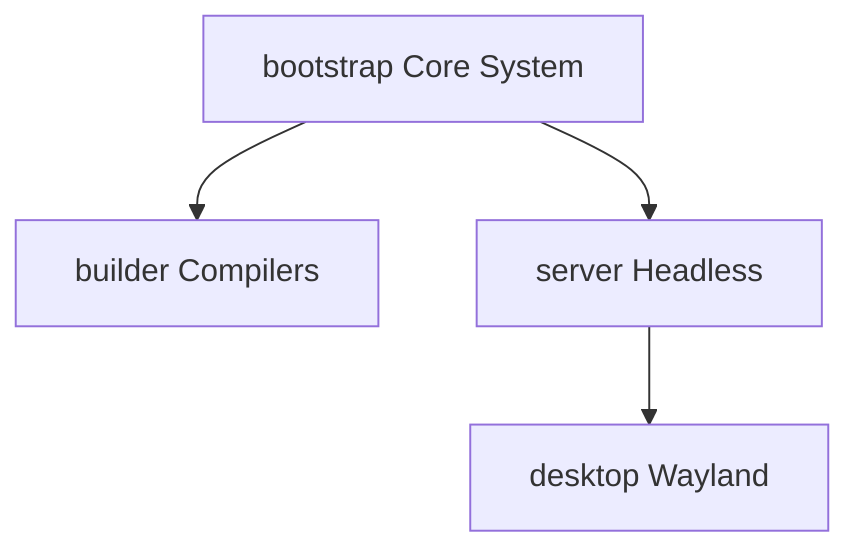

# Freeside OS: System Profiles & Package Registry

> [!NOTE]
> **Future State Specification**
> System profiles (and the inheritance configuration in `system/profiles.toml`) are part of the planned release orchestrator features and are **not yet implemented**. 
> 
> Currently, the system uses **Package Groups** (defined inside each package's `package.manifest`) as a mid-step to classify software. The compilation orchestrator (`straylight`) reads these groups (e.g., `base`, `builder`, `system`) to determine compile order. Once system profiles are implemented, they will define sets of groups mapping to target profiles (e.g. `Server` profile comprising `base` + `system` + `server` groups).

System profiles represent curated package collection baselines. Rather than maintaining static configuration templates in files, profiles are configured compositionally, and then compiled and flattened directly into each content-addressable upstream tree manifest (`trees/<tree_hash>.toml`). This ensures that the baseline dependencies for any profile remain strictly tied to, and validated against, a specific tree generation.

---

## 1. Profile Inheritance & Dependency Flow

Freeside minimizes composition bloat by strictly passing packages down an inheritance chain. When a node targets a specific profile, it implicitly acquires all packages from the parent layers:



---

## 2. Workspace Profile Ingestion Flow (Planned)

During a system-wide release build, the compilation coordinator will execute the following mapping step:
1.  Parses `system/profiles.toml`.
2.  Resolves inheritance nodes (e.g., recursive dependencies for `desktop` inherit everything in `server` and `core`).
3.  Verifies every listed dependency is compiled successfully in the current release batch.
4.  Generates a fully resolved flat array representing that profile, writing it directly to the target `trees/<tree_hash>.toml` manifest.

---

## 3. Profiles Configuration: `system/profiles.toml` (Planned)

This file uses composition and inheritance to keep profile configurations modular and DRY:

```toml
[profiles.core]
description = "Minimal baseline tools"
packages = ["musl", "uutils-coreutils", "systemd", "straylight"]

[profiles.server]
inherits = "core"
packages = ["podman", "fish", "neovim", "tmux"]
```

---

## 4. Package Groups Registry (Current State)

Rather than using profiles directly, the system currently classifies packages using **Package Groups** defined inside each package's `package.manifest`. The compilation orchestrator (`straylight`) uses these groups to organize dependencies and builds.

Below is the up-to-date registry of all packages sorted by their active package groups.

### A. The `base` Group

The foundational packages, containing the core C library (`musl`), shells, core utilities, and standard encryption/network layers.

| Package Name | Version | Description |
| :--- | :--- | :--- |
| **`base-files`** | `1.1.0` | Freeside OS base filesystem layout, directory topologies, and core OverlayFS templates |
| **`bash`** | `5.2.21` | GNU Bourne Again Shell |
| **`ca-certificates`** | `2024.07.02` | Mozilla CA certificate bundle for TLS verification |
| **`curl`** | `8.8.0` | Command line tool and library for transferring data with URLs |
| **`diffutils`** | `3.12` | GNU diffutils utilities |
| **`dosfstools`** | `4.2` | Utilities for creating and checking FAT/VFAT filesystems |
| **`file`** | `5.45` | Fine Free File Command |
| **`findutils`** | `4.10.0` | GNU utilities to locate files |
| **`gawk`** | `5.4.0` | GNU awk text processing utility |
| **`git`** | `2.45.1` | Fast, scalable, distributed revision control system |
| **`grep`** | `3.12` | GNU grep utility |
| **`gzip`** | `1.13` | GNU compression utilities |
| **`libffi`** | `3.4.6` | Portable foreign function interface library |
| **`linux-headers`** | `7.1` | Linux kernel headers for userspace development |
| **`musl`** | `1.2.6` | musl C library (libc) implementation for Freeside |
| **`ncurses`** | `6.5` | System V-compatible terminal screen handling library |
| **`openssl`** | `3.3.1` | Secure Sockets Layer toolkit |
| **`pambase`** | `20260616` | Base PAM configuration files |
| **`python3`** | `3.12.11` | Python Programming Language |
| **`readline`** | `8.2` | GNU readline library for interactive line editing |
| **`rsync`** | `3.3.0` | A fast, versatile, remote (and local) file-copying tool |
| **`sed`** | `4.10` | GNU stream editor |
| **`sqlite`** | `3.48.0-r1` | Self-contained, serverless, zero-configuration SQL database engine |
| **`tar`** | `1.35` | GNU tape archiver |
| **`uutils-coreutils`** | `0.0.28` | Rust implementation of GNU coreutils |
| **`zlib`** | `1.3.2` | A free, general-purpose, lossless data-compression library |

### B. The `builder` Group

The compilation toolchain, compiler infrastructure, and auxiliary build helpers.

| Package Name | Version | Description |
| :--- | :--- | :--- |
| **`bison`** | `3.8.2` | GNU general-purpose parser generator |
| **`bzip2`** | `1.0.8` | High-quality data compressor |
| **`ccache`** | `4.10.2` | A fast compiler cache |
| **`cmake`** | `3.29.3` | Cross-platform, open-source build system |
| **`flex`** | `2.6.4` | Fast lexical analyzer generator |
| **`gcompat`** | `1.1.0` | The GNU C Library compatibility layer for musl |
| **`gettext`** | `0.22.5` | GNU internationalization utilities |
| **`gperf`** | `3.1` | Perfect hash function generator |
| **`just`** | `1.36.0` | Just a handy command runner |
| **`llvm`** | `18.1.6` | The LLVM Compiler Infrastructure (including Clang, LLD, Compiler-RT) |
| **`m4`** | `1.4.19` | GNU macro processor |
| **`make`** | `4.4.1` | GNU Make utility to maintain groups of programs |
| **`meson`** | `1.4.0` | High-productivity build system |
| **`ninja`** | `1.12.1` | Small build system with a focus on speed |
| **`patch`** | `2.7.6` | Apply a diff file to an original |
| **`patchelf`** | `0.18.0` | A utility for modifying ELF binaries' dynamic linker and rpath |
| **`perl`** | `5.38.2` | Practical Extraction and Report Language |
| **`pkgconf`** | `2.2.0` | Package compiler and linker configuration tool |
| **`python-jinja2`** | `3.1.4` | A fast, expressive, extensible Python templating engine |
| **`python-markupsafe`** | `2.1.5` | Safely add untrusted strings to HTML/XML markup (Jinja2 dependency) |
| **`python-pyelftools`** | `0.33` | Python library for parsing and analyzing ELF files |
| **`rust`** | `1.96.0` | The Rust Programming Language Compiler and Cargo |
| **`setuptools`** | `69.5.1` | Easily download, build, install, upgrade, and uninstall Python packages |
| **`unzip`** | `6.0-r3` | ZIP extraction utility |
| **`xz`** | `5.6.2` | LZMA compression utilities |
| **`zstd`** | `1.5.6` | Fast real-time compression algorithm |

### C. The `system` Group

System management utilities, core system daemons, service orchestration, and main system libraries.

| Package Name | Version | Description |
| :--- | :--- | :--- |
| **`btrfs-progs`** | `7.0` | Btrfs filesystem utilities |
| **`cryptsetup`** | `2.8.6` | Disk encryption setup utility using dm-crypt |
| **`dbus-broker`** | `37` | Linux D-Bus Message Broker — high-performance drop-in replacement |
| **`glib2`** | `2.88.2` | Low-level core library for GNOME and GTK applications |
| **`iwd`** | `3.12` | Internet Wireless Daemon — lightweight Wi-Fi management |
| **`json-c`** | `0.17` | A JSON implementation in C |
| **`kdb`** | `3.2.0` | Linux kernel debugger frontend |
| **`kmod`** | `34.2` | Linux kernel module handling utilities |
| **`libarchive`** | `3.7.9` | Multi-format archive and compression library |
| **`libcap`** | `2.70` | POSIX 1003.1e capabilities library |
| **`libexpat`** | `2.6.2` | Stream-oriented XML parser library |
| **`musl-utils`** | `1.2.5` | Utility programs for musl libc (ldd, iconv, getent, getconf) |
| **`pam`** | `1.7.2` | Pluggable Authentication Modules library |
| **`polkit`** | `127` | PolicyKit authorization framework |
| **`procps-ng`** | `4.0.6` | Utilities for monitoring running processes (ps, top, free, etc.) |
| **`straylight`** | `1.0.0` | Straylight Package Manager CLI |
| **`systemd`** | `261.1` | System and Service Manager |
| **`tpm2-tools`** | `5.6` | TPM 2.0 command-line tools |
| **`tpm2-tss`** | `4.1.3` | TPM 2.0 Software Stack library |
| **`tzdata`** | `2026b` | Timezone and daylight-saving time data |
| **`util-linux`** | `2.40.1` | Miscellaneous system utilities for Linux |
| **`vim`** | `9.1.1000` | Improved vi-style text editor |

### D. The `linux` Group

Linux kernel builds, initramfs generation, UKI images, and kernel-adjacent support libraries.

| Package Name | Version | Description |
| :--- | :--- | :--- |
| **`argp-standalone`** | `1.3` | Standalone implementation of the argp argument-parsing interface |
| **`base-initramfs`** | `1.0.0` | Freeside base initramfs image and early boot scripts |
| **`bc`** | `1.08.2` | Arbitrary precision numeric processing language (kernel build dependency) |
| **`elfutils`** | `0.195` | ELF object file utilities and libraries |
| **`linux-kernel`** | `7.1.0` | Linux kernel source build (vmlinuz) |
| **`linux-mainline`** | `7.1.0` | Linux mainline kernel configuration and patches |
| **`linux-modules`** | `7.1.0` | Linux kernel loadable modules |
| **`linux-uki`** | `7.1.0` | Unified Kernel Image (UKI) for direct UEFI boot |
| **`musl-fts`** | `1.2.7` | Implementation of fts(3) for musl libc |
| **`musl-obstack`** | `1.1` | Implementation of obstack for musl libc |
| **`python-pefile`** | `2024.8.26` | Python library for parsing and working with PE (Portable Executable) files |

### E. The `live-image` Group

Tools for building bootable live ISO images and related media utilities.

| Package Name | Version | Description |
| :--- | :--- | :--- |
| **`mtools`** | `4.0.49` | Utilities to access MS-DOS disks without mounting them |
| **`squashfs-tools`** | `4.7.5` | Tools for creating and extracting SquashFS filesystems |
| **`xorriso`** | `1.5.6.pl02` | ISO 9660 Rock Ridge filesystem creation and manipulation tool |

### F. The `server` Group

User-facing server utilities, interactive shells, container runtimes, and network diagnostic tools.

| Package Name | Version | Description |
| :--- | :--- | :--- |
| **`bmon`** | `4.0` | Bandwidth monitor and rate estimator |
| **`fish`** | `4.8.0` | Friendly interactive shell |
| **`htop`** | `3.5.1` | Interactive process viewer |
| **`httpie`** | `3.2.4` | User-friendly command-line HTTP client |
| **`jq`** | `1.8.2` | Lightweight and flexible command-line JSON processor |
| **`nmap`** | `7.99` | Network exploration tool and security/port scanner |
| **`podman`** | `5.8.3` | Daemonless container engine for OCI containers |
| **`podman-compose`** | `1.6.0` | Docker Compose compatible tool for Podman |
| **`podman-docker`** | `5.8.3` | Docker CLI compatibility wrapper for Podman |
| **`socat`** | `1.8.1.1` | Multipurpose relay for bidirectional data transfer |
| **`strace`** | `7.1` | System call tracer for diagnostics and debugging |
| **`zsh`** | `5.9.1` | Z shell — powerful interactive shell and scripting language |
