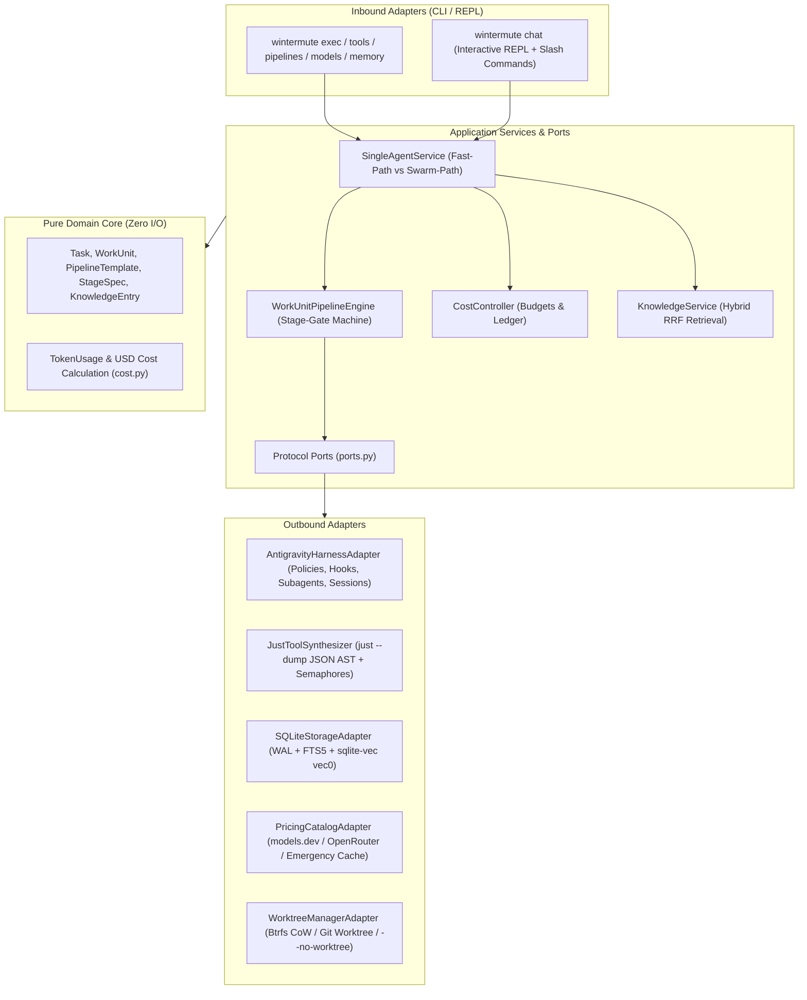

# Wintermute Platform: System Architecture Specification

This document specifies the system architecture, domain boundaries, stage-gate pipeline engine, and storage/runtime contracts for **Wintermute**, the autonomous development platform for Freeside OS built on the **Google Antigravity Python SDK** (`google-antigravity`).

---

## 1. Architectural Blueprint & Hexagonal Layers

Wintermute uses a Pragmatic Hexagonal (Ports & Adapters) architecture under [wintermute/app/](../../wintermute/app) so pure domain logic and pipeline state machines remain isolated from SDK, SQLite, git/Btrfs, and terminal specifics:

### Layer Responsibilities

1. **Domain Layer ([wintermute/app/domain/](../../wintermute/app/domain)):** Pure dataclasses and enums (`Task`, `WorkUnit`, `SubagentRun`, `PipelineTemplate`, `StageSpec`, `AgentRole`, `KnowledgeEntry`) in [models.py](../../wintermute/app/domain/models.py) and token/USD pricing math in [cost.py](../../wintermute/app/domain/cost.py).
2. **Application Layer ([wintermute/app/application/](../../wintermute/app/application)):**
   - **Ports ([ports.py](../../wintermute/app/application/ports.py)):** Async `Protocol` contracts (`StoragePort`, `AgentHarnessPort`, `WorktreePort`, `JustToolProviderPort`, `PricingCatalogPort`) and callback types (`EventCallback`, `InteractionCallback`, `StopGateCallback`, `PreWriteCallback`).
   - **Orchestrator ([single_agent_service.py](../../wintermute/app/application/single_agent_service.py)):** Classifies tasks between Fast-Path (single `WorkUnit`) and Swarm-Path (`tech_lead` decomposition via `dispatch_work_unit`), handles escalation recovery on pipeline failures, and supports forward-looking budget top-ups (`grant_task_budget`) and `--resume`.
   - **Pipeline Engine ([pipeline.py](../../wintermute/app/application/pipeline.py)):** Deterministic stage-gate runner supporting `AGENT`, `GATE`, and `COMMIT` stages, `@hooks.stop` file-edit enforcement, `skip_next_gate_if_unmodified`, automatic `pkg::logs` attachment when `attach_build_logs = true`, and pre-commit `last_file_modified_at <= last_gate_passed_at` guards.
   - **Cost Controller ([cost_service.py](../../wintermute/app/application/cost_service.py)):** Pre-turn and post-turn enforcement of per-task and daily USD budgets, transitioning tasks to `PAUSED_BUDGET` on limit breach.
   - **Knowledge Service ([knowledge_service.py](../../wintermute/app/application/knowledge_service.py)):** Embeds notes with `gemini-embedding-001` (`768` dims) or offline deterministic hashing, primes `AGENT` prompts, captures automatic/explicit notes, and consolidates stale entries per `(domain, target)`.
3. **Bootstrap & Config ([wintermute/app/bootstrap/](../../wintermute/app/bootstrap)):** Loads and merges [wintermute.toml](../../wintermute/wintermute.toml) + `.wintermute/config.toml`, resolves markdown role files + overrides, validates `agentskills.io` skills, and wires the dependency container ([container.py](../../wintermute/app/bootstrap/container.py)).
4. **Outbound Adapters ([wintermute/app/adapters/outbound/](../../wintermute/app/adapters/outbound)):** Concrete implementations of every port.
5. **Inbound Adapters ([wintermute/app/adapters/inbound/](../../wintermute/app/adapters/inbound)):** Click + Rich CLI and REPL ([main.py](../../wintermute/app/adapters/inbound/cli/main.py), [ui.py](../../wintermute/app/adapters/inbound/cli/ui.py)).

---

## 2. Three-Tier Configuration, Roles & `agentskills.io` Skills

Configuration separates infrastructure, role permissions, and reusable workflows cleanly:

| Tier | Source Files | Responsibility |
| :--- | :--- | :--- |
| **Platform & Pipelines** | [wintermute.toml](../../wintermute/wintermute.toml), `.wintermute/config.toml` | `[models.*]` profiles (Gemini API, Vertex AI, `openai_compat`, `litert`), `[agents.*]` model/`thinking_level`/`compaction_token_threshold`/budget defaults, `[cost]`, `[memory]`, `[concurrency.build_locks]`, `[pipeline]` templates, and `domain_defaults`. |
| **Role Definitions** | `wintermute/agents/<role>.md`, `.wintermute/agents/<role>.md` | YAML frontmatter (`description`, `read_only`, `thinking_level`, `compaction_token_threshold`, `skills`, `allowed_subagents`, `allowed_tools`, `denied_tools`) + markdown system instructions. Supports `@domain`, `@read_only`, and glob tool patterns. |
| **Agent Skills** | `wintermute/skills/<skill>/SKILL.md`, `.wintermute/skills/<skill>/SKILL.md` | Follows the [agentskills.io](https://agentskills.io/) specification (`name`, `description` frontmatter) surfaced via SDK `skills_paths` for progressive disclosure and stage prompt injection. |

---

## 3. Pluggable Stage-Gate Pipelines & SDK Enforcement

### Stage-Gate Templates

| Template | Default Domains | Flow & Invariants |
| :--- | :--- | :--- |
| **`package_lifecycle`** | `packages` | `scaffold_or_edit` -> `static_verify` (`pkg::verify`, `pkg::resolve`) -> `sandbox_build` (`pkg::build`) -> `troubleshoot_build` (`run_only_on_failure = true`, `attach_build_logs = true`) -> `compliance_review` (`read_only`, `pass_git_diff`, `skip_next_gate_if_unmodified`) -> `reverify_after_review` -> `commit` |
| **`tdd_coding`** | `straylight`, `fstools`, `wintermute` | `write_tests` -> `implement` -> `verify_tests` (`@domain_test`) -> `troubleshoot` (on fail) -> `review` (`skip_next_gate_if_unmodified`) -> `validate_refactor` -> `commit` |
| **`standard_change`** | `docs` | `edit` (`doc_writer` when `domain == "docs"`) -> `review` -> `commit` |
| **`investigation_audit`** | Explicit | `research` -> `synthesize` (both `read_only = true`, zero commits or mutations) |

### Antigravity SDK Guardrails ([antigravity_harness.py](../../wintermute/app/adapters/outbound/antigravity_harness.py))

* **Capabilities & Subagents:** `CapabilitiesConfig` explicitly enables filtered built-in tools (`read_only` stages strip `edit_file`, `create_file`, and `run_command`), populates `SubagentConfig` targets from `allowed_subagents`, and propagates role `AgentRoleConfig.thinking_level` (or escalation override via `GeminiModelOptions.thinking_level`) onto Gemini/Vertex targets.
* **Deny-First Exact Policy:** Constructs ordered `PolicyBuilder` rules: blocks raw `cargo`/`pytest`/`straylight`/`fstools` invocations inside `run_command` via `should_block_raw_command`, applies explicit denies (`read_only` writes + `denied_tools`), adds exact `policy.allow(name)` entries for allowed synthesized `just_*` and built-in tools, and finishes with `policy.deny("*", ..., name="deny_all")`.
* **Runtime Hooks & Sessions:** Attaches `@hooks.stop` (verifying worktree edits before allowing stop), `@hooks.pre_tool_call_decide` (lazy sub-repo materialization prior to writes), `@hooks.on_interaction` (interactive clarification routing), `@hooks.post_tool_call`, and 36-char UUID4 `conversation_id` persistence with `SessionContinuationMode.CREATE_OR_RESUME`.

---

## 4. Tool Synthesis, Unified State & Worktree Isolation

* **Just AST Synthesis ([just_synthesizer.py](../../wintermute/app/adapters/outbound/just_synthesizer.py)):** Inspects `just --dump --dump-format json`, maps recipe targets and parameters into typed async Python callables with `inspect.Signature`, preserves intermediate empty optional positional parameters, resolves `pkg_name` <-> `target` aliases safely, falls back from `pkg::verify` to `pkg::verify-all` when untargeted, and enforces `asyncio.Semaphore` build locks (`pkg::build`, `pkg::build-group`, `sandbox::build`, `live::build`, `live::run`).
* **Package Tool Consolidation:** [fstools/src/fstools/pkg.py](../../fstools/src/fstools/pkg.py) and [just/pkg.just](../../just/pkg.just) expose `audit` (OSV.dev), `checksum`, `logs`, `verify`, `verify-all`, `resolve`, `build`, `create`, `convert`, `info`, and `list`.
* **Unified SQLite + Hybrid Memory ([sqlite_storage.py](../../wintermute/app/adapters/outbound/sqlite_storage.py)):** WAL-mode database holding `tasks`, `work_units`, `subagent_runs`, `task_events`, `cost_ledger`, `model_pricing_cache`, `knowledge_entries`, `knowledge_fts` (`FTS5`), and `knowledge_vec` (`sqlite-vec` `vec0` with pure-Python cosine fallback), fused via Reciprocal Rank Fusion (`k = 60`).
* **Worktree & Build Isolation ([worktree_manager.py](../../wintermute/app/adapters/outbound/worktree_manager.py)):** Provisioned lazily under `.wintermute/worktrees/<task_id>` with Btrfs CoW snapshots or per-sub-repo `git worktree add -B wintermute/<task_id>` and isolated `build/workspace/<task_id>` directories (or in-place via `--no-worktree`), exposing multi-repo diffs and local fast-forward merges.

For operational commands and REPL usage, see the [Wintermute Platform Guide](../guides/wintermute.md).
