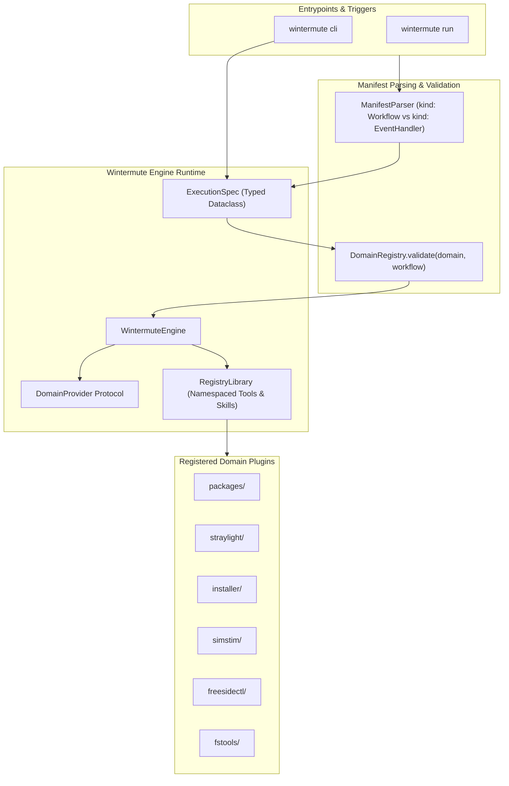

# Wintermute Platform: System Architecture Specification

This document specifies the system architecture, core engine runtime, domain registry, and execution interfaces for **Wintermute**, the autonomous development platform for Freeside OS.

---

## 1. Architectural Blueprint & Connectivity

Wintermute is structured as an extensible multi-domain agentic engine. Interfaces (`wintermute cli` and `wintermute run`) construct typed `ExecutionSpec` instances, which the core `WintermuteEngine` dispatches across registered component domains:

---

## 2. Core Subsystems

### A. Execution Specification (`ExecutionSpec`)
Defined in [types.py](wintermute/app/types.py). `ExecutionSpec` is a frozen, strongly typed dataclass encapsulating execution metadata:
* **`domain`**: Target component domain (`DomainKind` alias for `KnownDomain | str`).
* **`workflow`**: Requested workflow verb (`WorkflowKind` alias for `KnownCoreWorkflow | str`).
* **`target`**: Target entity (e.g. package name, crate name, VM disk image).
* **`params`**: Arbitrary parameters dictionary.
* **`execution_env`**: Execution containment (`"host"` vs `"simstim"` sandbox).

### B. Dynamic Domain Registry (`DomainRegistry`)
Defined in [registry_domains.py](wintermute/app/registry_domains.py). Manages component plugin discovery and runtime validation:
* **Autodiscovery**: Scans `wintermute/app/domains/` and Python `entry_points(group="wintermute.domains")`.
* **Workflow Validation**: Validates `workflow_name in self.workflows if self.workflows else workflow_name in KnownCoreWorkflow`.

### C. Namespaced Tool & Skill Library (`RegistryLibrary`)
Defined in [registry.py](wintermute/app/registry.py). Houses tools and skills registered under namespaces (`namespace:name`). Supports wildcard resolution (e.g., `straylight:*`).

### D. Provider Protocol (`DomainProvider`)
Defined in [provider.py](wintermute/app/provider.py). Defines the domain provider protocol. Defaults to `DefaultDomainProvider` when no custom provider factory is specified.

### E. Rust Diagnostic Parser (`RustDiagnosticParser`)
Defined in [rust_diagnostics.py](wintermute/app/parsers/rust_diagnostics.py). Executes `cargo check --message-format=json` and `cargo clippy` to extract structured JSON compiler errors into LLM context.

---

## 3. Kubernetes-Style Manifest Model

Wintermute supports declarative YAML specifications (`apiVersion: "wintermute.freeside.os/v1"`):

* **`kind: Workflow`**: Executed on-demand or via system timers (`systemd.timer` / K8s CronJobs). Maps steps directly to `ExecutionSpec` tasks.
* **`kind: EventHandler`**: Executed as a long-running service. Connects pluggable `tasks.source` Python adapters (webhooks, polling) to target workflows.

---

## 4. Multi-Domain Matrix

| Domain | Description | Key Workflows |
| :--- | :--- | :--- |
| **`packages`** | Freeside package manifests and build recipes | `create`, `import`, `fix`, `upgrade`, `review`, `security_audit` |
| **`straylight`** | Rust CLI client and `straylightd` daemon | `check`, `clippy_fix`, `audit_rpc`, `benchmark` |
| **`installer`** | Ratatui TUI installer application | `check`, `qemu_boot_test`, `dps_uuid_audit` |
| **`simstim`** | Developer sandboxes and snapshots | `provision`, `snapshot_verify` |
| **`freesidectl`** | Unified system management CLI | `scaffold_subcommand`, `completion_sync` |
| **`fstools`** | Repository indexing and chunking scripts | `schema_validate`, `caidx_audit` |
